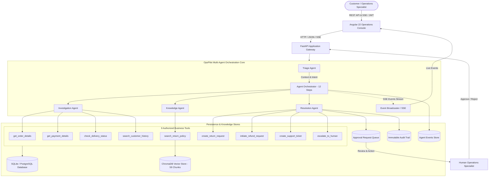
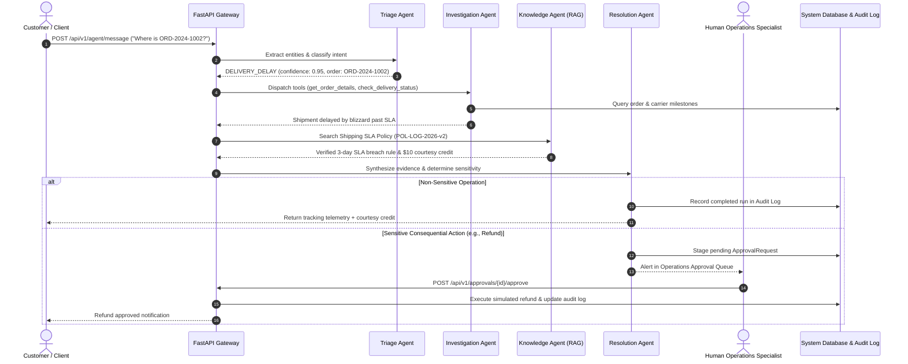

# OpsPilot AI – Autonomous E-Commerce Operations Platform

[](https://fastapi.tiangolo.com)
[](https://angular.dev)
[](https://www.trychroma.com)
[](https://www.python.org)
[](documentation/ACCEPTANCE_TEST_REPORT.md)
[](LICENSE)

> **OpsPilot AI** is an enterprise-grade autonomous operations platform that investigates, validates, and resolves e-commerce operational bottlenecks (delivery delays, payment discrepancies, orphan charges, return requests, and simulated refunds) through multi-agent orchestration, grounded RAG policy retrieval, verifiable backend tools, and Human-in-the-Loop (HITL) approval gates.

---

## 1. Business Problem & Solution

### The Real Business Challenge
Medium-sized e-commerce companies lose thousands of operational hours handling order delays, payment failures, orphan transactions, return authorizations, and customer disputes manually. Support staff spend 80% of their time cross-referencing order records, querying carrier tracking systems, looking up company policies, and calculating return eligibility.

### The OpsPilot Solution
OpsPilot AI acts as an **autonomous operations engineer**:
1. **Understands & Triages** customer inquiries with high precision across 10 operational intents.
2. **Investigates** across live databases, transaction logs, and carrier tracking systems using 9 authorized backend tools.
3. **Retrieves Grounded Policies** using a local vector store (ChromaDB) to verify return windows, SLA guarantees, and payment discrepancy rules.
4. **Streams Real-Time Execution** over Server-Sent Events (SSE) with persistent audit events, reconnect support, and full inspection.
5. **Enforces Consequential Guardrails** via Human-in-the-Loop approval gates for financial operations (refunds, order cancellations).
6. **Maintains Cryptographic Auditability** by recording all automated actions and human decisions in an immutable audit log.

---

## 2. System Architecture



---

## 3. Seven Custom Operational Interfaces

OpsPilot AI delivers a purpose-built, high-density operations center designed around real engineering workflows:

1. **Operations Command Center (`/overview`):**
   - Live GMV metrics, order fulfillment distribution, autonomous success rate telemetry, and live SSE event indicator.
2. **Agent Investigation Workspace (`/agent`):**
   - 3-column investigative workbench with one-click test incident scenarios, multi-agent real-time streaming, and tool execution logs.
3. **Live Execution Inspector (`/inspector`):**
   - Real-time agent execution inspection with live SSE event feed, run replay, and raw JSON payload inspection.
4. **Business Data Explorer (`/orders`, `/payments`, `/shipments`, `/returns`, `/tickets`):**
   - Full operational records with status badges, carrier tracking milestones, and orphan payment alerts.
5. **Human Approval Console (`/approvals`):**
   - Financial and operational approval gate with policy evaluation summaries, operator review actions, and comment logs.
6. **Knowledge Intelligence Center (`/knowledge`):**
   - Interactive policy search engine grounded in 59 ChromaDB vector embeddings with similarity distance scores.
7. **Audit & Execution History (`/audit`):**
   - Cryptographically linked operational audit trail recording all automated agent actions and human decisions.

---

## 4. Multi-Agent Pipeline & 12-Step Execution Flow



---

## 5. Seeded Demo Accounts & Credentials

The database comes pre-seeded with 30 orders, 31 payments (including orphan transactions), 20 shipments, 20 customers, 10 support tickets, and 3 user accounts with bcrypt hashed passwords:

| Role | Email | Password | Permissions |
| :--- | :--- | :--- | :--- |
| **Admin** | `admin@opspilot.ai` | `Admin@OpsPilot2026!` | Full system access, approval authorizations, document uploads. |
| **Ops Specialist** | `agent@opspilot.ai` | `Agent@OpsPilot2026!` | Agent workspace, approval queue reviews, ticket/order management. |
| **Customer** | `customer@opspilot.ai` | `Customer@OpsPilot2026!` | Personal orders, shipment tracking, refund requests. |

---

## 6. Quickstart Guide

### Prerequisites
- Python 3.11+
- Node.js 18+ & npm

### Backend Setup
```bash
# 1. Activate virtual environment
cd "d:\OpsPilot AI"
.\venv\Scripts\Activate.ps1

# 2. Seed database & build sample policy PDFs
python scripts/seed_database.py
python scripts/generate_sample_pdfs.py

# 3. Ingest enterprise policy documents into ChromaDB
python scripts/ingest_policies.py

# 4. Start the FastAPI backend server
uvicorn backend.app.main:app --host 127.0.0.1 --port 8000
```

### Frontend Setup
```bash
# In a new terminal window:
cd "d:\OpsPilot AI\frontend"
npm start
```
The operations dashboard will launch at `http://localhost:4200`.

---

## 7. Acceptance Test Suite (10 / 10 Passing)

All 10 required end-to-end acceptance tests run against actual database models and endpoints:

```bash
# Run acceptance test suite
pytest backend/tests/test_e2e_acceptance.py -v
```

Read the complete evidence report: [ACCEPTANCE_TEST_REPORT.md](documentation/ACCEPTANCE_TEST_REPORT.md).

---

## 8. Deployment Guides

- **Vercel (Frontend):** Configured via `frontend/vercel.json` with SPA routing and security headers.
- **Render (Backend):** Configured via `render.yaml`, `Procfile`, and `Dockerfile` with PostgreSQL support.
- Complete step-by-step instructions: [DEPLOYMENT_GUIDE.md](documentation/DEPLOYMENT_GUIDE.md).

---

## 9. License & Author
Engineered for demonstration during AI Engineering, Full Stack Development, and Forward Deployment technical interviews. Released under the MIT License.
