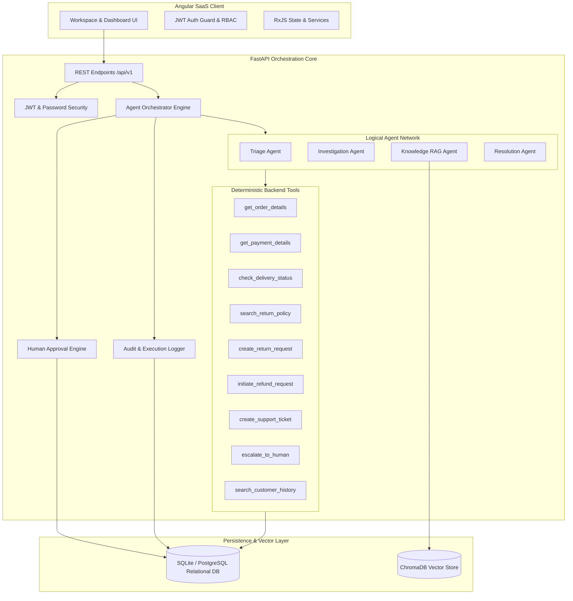

# OpsPilot AI – Architecture & Technical Implementation Plan

**OpsPilot AI** is an enterprise-grade autonomous e-commerce operations platform designed to automate investigation, policy retrieval (RAG), tool calling, and human-in-the-loop approvals for complex customer operational issues.

---

## 1. High-Level Architecture

---

## 2. Multi-Phase Roadmap

| Phase | Title | Scope | Status |
|---|---|---|---|
| **Phase 1** | **Foundation & Data Engine** | Project scaffolding, FastAPI setup, Angular setup, SQLAlchemy models (18 tables), JWT authentication & RBAC, realistic seed data (20 customers, 30 orders, 20 products, 31 payments, 20 shipments, 10 tickets, all 7 business scenarios), automated pytest suite. | **COMPLETED** |
| **Phase 2** | **Core Business Domain APIs** | CRUD & domain endpoints for Orders, Payments, Shipments, Returns, Refunds, and Support Tickets. Operational business rules: delivery delay detector, payment discrepancy investigator, 30-day refund eligibility validator, simulated refund requester with approval hook. 28 automated tests passing. | **COMPLETED** |
| **Phase 3** | **AI Agent & Tool Execution** | Deterministic orchestrator, 9 business tools with input/output schemas, execution timeouts, loop prevention, structured execution logging. | Planned |
| **Phase 4** | **Enterprise Knowledge RAG** | Document ingestion (PDF & TXT), chunking, embeddings, ChromaDB vector retrieval, source citations, prompt defense against prompt injections. | Planned |
| **Phase 5** | **Multi-Agent Orchestration & HITL** | Triage, Investigation, Knowledge, Resolution agents with shared validated state, Human-in-the-loop approval workflow, operations queue escalations, audit trail. | Planned |
| **Phase 6** | **Angular Operations Workspace** | Dark SaaS dashboard theme (`#0A0E27`, `#00D4FF`), Agent Workspace with interactive timeline, approval queue, analytics charts, knowledge manager. | Planned |
| **Phase 7** | **E2E Testing & Documentation** | Automated integration tests for all 6 end-to-end scenarios (A to F), Swagger documentation, comprehensive README.md, and `PROJECT_WALKTHROUGH.md` for technical interviews. | Planned |

